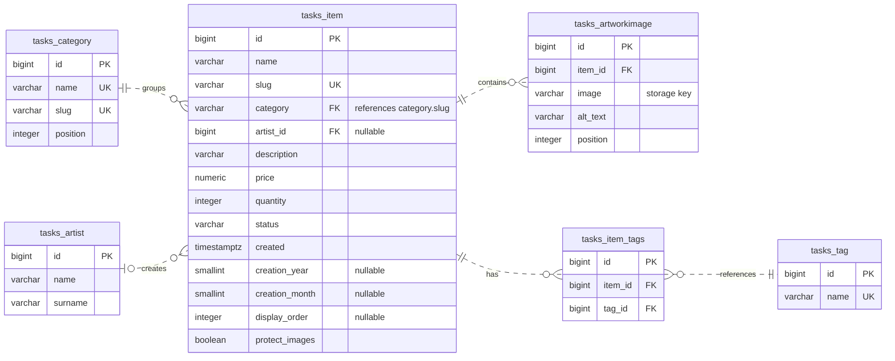
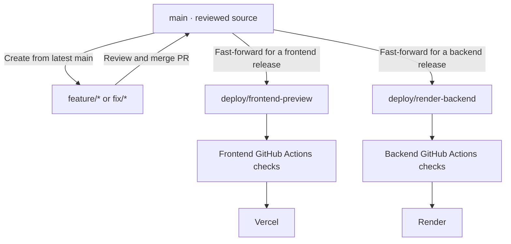
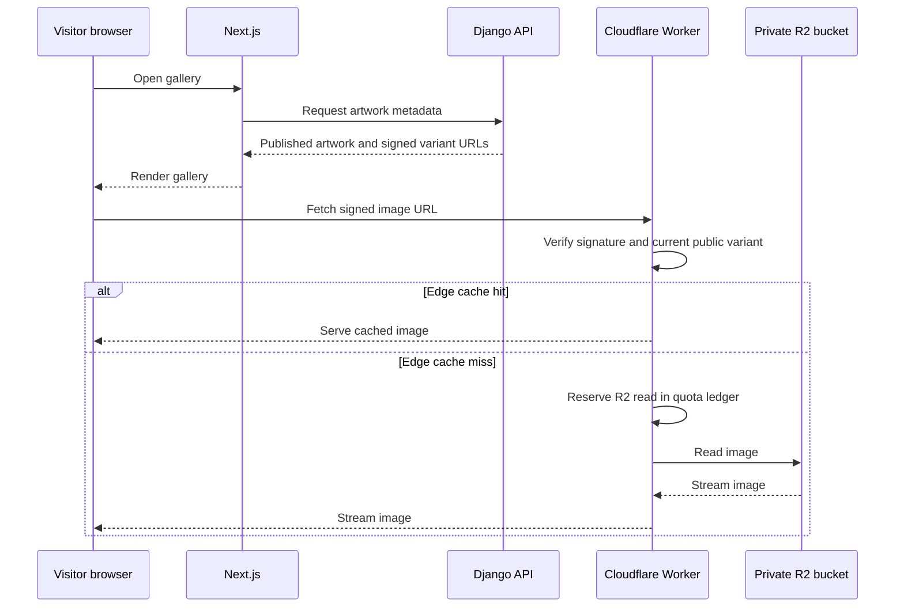

<h1 align="center">Personal Art Gallery</h1>

[](https://arts.kaancinar.com)

<p align="center">Visit the live portfolio →  <a href="https://arts.kaancinar.com"> arts.kaancinar.com</a></p>

This is the online home for Aydın Kaan Çınar's ceramics, objects, and illustrations. It presents the artwork clearly, gives visitors a Clay Studio to explore pottery forms, and runs with zero recurring application-hosting charges at current usage. The [design decisions](docs/DESIGN_DECISIONS.md) explain the choices and their limits.

## What is here

- **Gallery:** responsive artwork pages, categories, search, date filters, pagination, image viewer, and light/dark themes.
- **Clay Studio:** shape a vessel, estimate clay weight, undo and redo changes, save a design in the browser, or share it in a URL. The weight adjustment is provisional; see the [model notes](docs/CLAY_STUDIO.md).
- **Owner-only editing.** Gallery owners manage artwork through Django admin with a password and authenticator-app MFA. API writes also require an active, MFA-verified staff session.
- **Sharing and discovery:** artwork-specific previews and metadata, a sitemap, robots rules, and structured data.
- **Zero-cost hosting.** The live gallery runs with zero recurring application-hosting charges at current usage, supported by storage quota controls, backend keepalive checks, and optimized image variants. See the [hosting design](docs/DESIGN_DECISIONS.md#keeping-hosting-costs-down).

Visitors do not create accounts, check out, or upload artwork. [Clay Studio](https://arts.kaancinar.com/clay-studio) and the [privacy policy](https://arts.kaancinar.com/privacy) are also live.

## How it works


Next.js renders the public pages and asks Django for artwork data. Image URLs stay under the gallery domain through a Next.js rewrite, but Django checks publication and image-protection rules before reading files from the private gateway. The browser never receives R2 credentials or a direct bucket URL.

Django stores artwork records and staff sessions in Neon. The Cloudflare Worker reserves R2 usage before reads and writes, checks account usage every 15 minutes, and can stop billable access at conservative limits. Its cutoff is an application safeguard, not a Cloudflare billing guarantee. See the [gateway design](docs/R2_QUOTA_GATEWAY.html).

See the [image delivery investigation and benchmark](docs/IMAGE_DELIVERY.md) for the current request path, caching tradeoffs, and repeatable timing checks.

GitHub Actions applies the keepalive configuration when it changes on `main`. cron-job.org runs the checks and emails the owner on failure, recovery, or automatic disablement. See the [keepalive design](docs/DESIGN_DECISIONS.md#render-keepalive).

Gallery cards use small WebP variants, artwork pages use larger detail variants, and sharing links use 1200 × 630 previews. Clicking **View image** loads the original for unprotected work. For work with **Protect images** checked, all public copies are watermarked and the original remains staff-only. See [image behavior](frontend/README.md#image-delivery-and-search).

**Zero recurring application-hosting cost was a design constraint.** The gallery combines Vercel Hobby, Render Free, Neon Free, and Cloudflare/Resend free allowances. A custom R2 gateway reserves usage before storage operations, enforces quota cutoffs, and sends alerts. Scheduled keepalive checks keep the backend warm, while WebP card and detail variants reduce image transfer sizes. These choices support the live gallery at zero recurring application-hosting cost at current usage. The [cost and tradeoff notes](docs/DESIGN_DECISIONS.md#keeping-hosting-costs-down) cover provider limits and the separate domain renewal cost.

### Gallery database relationships



The join table enforces uniqueness on `(item_id, tag_id)`. Django protects categories in use, clears artist references when an artist is deleted, and deletes an artwork's image records when the artwork is deleted.

Artwork is represented by `Item` in the [Django models](items/models.py). PostgreSQL stores image references, alt text, and display order. Production image files live in private Cloudflare R2.

### Where to look

| If you are changing… | Start here |
| --- | --- |
| Gallery pages, filters, navigation, viewer | [`frontend/app/`](frontend/app/), [`frontend/components/`](frontend/components/) |
| Clay Studio and its estimates | [`frontend/app/clay-studio/`](frontend/app/clay-studio/), [`frontend/lib/clay.ts`](frontend/lib/clay.ts), [model notes](docs/CLAY_STUDIO.md) |
| Metadata, sitemap, robots, privacy page | [`frontend/app/layout.tsx`](frontend/app/layout.tsx), [`frontend/app/sitemap.ts`](frontend/app/sitemap.ts), [`frontend/app/robots.ts`](frontend/app/robots.ts), [`frontend/app/privacy/page.tsx`](frontend/app/privacy/page.tsx) |
| Artwork data and admin | [`items/models.py`](items/models.py), [`items/serializers.py`](items/serializers.py), [`items/views.py`](items/views.py), [`items/admin.py`](items/admin.py) |
| Image generation and access | [`items/image_variants.py`](items/image_variants.py), [`items/validators.py`](items/validators.py), [`items/views.py`](items/views.py), [`frontend/next.config.ts`](frontend/next.config.ts) |
| Authentication and request limits | [`config/settings_base.py`](config/settings_base.py), [`config/settings_production.py`](config/settings_production.py), [`items/permissions.py`](items/permissions.py), [`items/public_read_limit.py`](items/public_read_limit.py) |
| R2 quota and alerts | [`cloudflare/r2-gateway/`](cloudflare/r2-gateway/), [`items/storage_gateway.py`](items/storage_gateway.py) |
| Builds and releases | [`Dockerfile`](Dockerfile), [GitHub workflows](.github/workflows/), [branch workflow](docs/BRANCH_WORKFLOW.md) |

The Django app lives in `items/`, but its database app label is `tasks` for migration compatibility. Use that label if an app-specific migration command needs one.

## Run your own gallery

Fork this repository to build a gallery for your own work. A fresh clone starts with an empty artwork database and stores uploads locally in `media/`. The default setup uses SQLite.

### Prerequisites

Install or have these available before running the setup commands.

| Dependency | Used for |
| --- | --- |
| Git and a GitHub account | Forking and cloning the repository |
| Python 3.12 with `pip`, `venv`, and SQLite support | Running Django and the local database |
| Node.js 24 with npm | Installing and running the Next.js frontend |
| A web browser | Viewing the gallery and managing artwork |
| An authenticator app supporting TOTP | Enrolling in MFA and signing in to Django admin |

Check the command-line tools in your terminal.

```bash
git --version
python3.12 --version
python3.12 -m pip --version
python3.12 -c "import venv, sqlite3"
node --version
npm --version
```

The setup below installs Django, Pillow, and the other Python packages from
`requirements-lock.txt`, then Next.js, React, and the frontend packages with
`npm ci`. SQLite and local media storage cover the default development setup.
The [Docker and cloud-connected workflow](docs/LOCAL_DOCKER.md) has its own setup guide.

### Start locally

Fork the repository on GitHub, then clone your fork (replace `YOUR_USERNAME` below). These commands use a macOS/Linux shell.

```bash
git clone https://github.com/YOUR_USERNAME/kaan-gallery.git
cd kaan-gallery
python3.12 -m venv .venv
./.venv/bin/python -m pip install -r requirements-lock.txt
./.venv/bin/python manage.py migrate
./.venv/bin/python manage.py createsuperuser
./.venv/bin/python manage.py runserver
```

In another terminal, from your cloned repository:

```bash
cd frontend
npm ci
npm run dev
```

Open [localhost:3000](http://localhost:3000). The gallery will be empty until you publish your first piece. `BACKEND_ORIGIN` defaults to `http://127.0.0.1:8000`.

### Add your first piece

1. Sign in with your new superuser at [the MFA login](http://127.0.0.1:8000/account/login/), then open [two-factor setup](http://127.0.0.1:8000/account/two_factor/setup/). Scan the QR code with your authenticator app and enter its code to finish enrollment.
2. Open [Django admin](http://127.0.0.1:8000/admin/). Under **Items**, choose **Add**. Enter a name, price (use `0` if appropriate), description, and category. The initial categories are created by migrations; you can manage them under **Categories**.
3. In **Artwork images**, upload your own JPEG, PNG, or WebP and add descriptive alt text. Each image must be at most 10 MiB and 25 million pixels. Card, detail, and sharing variants are generated automatically.
4. Set **Status** to **Published**, save, and refresh the gallery. Use **Draft** while preparing a piece. Lower **Gallery position** values appear first.

### Make it yours

Update these files with your own identity and assets before publishing your gallery.

| What to customize | Where to edit |
| --- | --- |
| Site name, description, and sharing metadata | [`frontend/lib/site.ts`](frontend/lib/site.ts) |
| Header name, logo references, and accessible label | [`frontend/components/GalleryHeader.tsx`](frontend/components/GalleryHeader.tsx) |
| Website, email, and Instagram links | [`frontend/components/ThemeToggle.tsx`](frontend/components/ThemeToggle.tsx) |
| Footer identity and website link | [`frontend/components/GalleryFooter.tsx`](frontend/components/GalleryFooter.tsx) |
| Home-page heading and artwork-page titles/descriptions | [`frontend/app/page.tsx`](frontend/app/page.tsx), [`frontend/app/artworks/[slug]/page.tsx`](frontend/app/artworks/[slug]/page.tsx) |
| Logo images, favicon, and sharing preview | [`frontend/public/images/`](frontend/public/images/), [`frontend/app/icon.svg`](frontend/app/icon.svg), [`frontend/public/opengraph-image.png`](frontend/public/opengraph-image.png) |
| Watermark text for protected artwork | The `watermark()` function in [`items/image_variants.py`](items/image_variants.py); change it before uploading protected images |
| Privacy policy and contact details | [`frontend/app/privacy/page.tsx`](frontend/app/privacy/page.tsx), adjusted to your own hosting and data practices |

For local development, create `frontend/.env.local` with `SITE_URL=http://localhost:3000`. This controls canonical and sharing URLs and the Clay Studio watermark. When deploying, set `SITE_URL` to your gallery's public URL and `BACKEND_ORIGIN` to your backend URL in your frontend host's environment settings.

Replace the README banner and personal project description in your fork too. Use your own artwork and branding as described in [Copyright and permissions](#copyright-and-permissions). Keep the MIT copyright and license notices with the code.

For deployment, see [How changes reach the site](#how-changes-reach-the-site) and the linked hosting guides. The live gallery's deployment workflows need your own provider configuration and secrets.

<details>
<summary>Existing project workstation and cloud-connected development</summary>

On the project workstation, [Docker Compose](docs/LOCAL_DOCKER.md) is the usual local backend. It uses a private, ignored `.env.docker` file and connects to Neon and the R2 gateway. The [Neon setup guide](docs/NEON_SETUP.md) explains the alternative virtual-environment connection. Existing environment settings or a private `.artwork-storage.json` file can also select cloud storage. Check which database and storage settings are active before changing real artwork. Keep credentials, database dumps, MFA recovery codes, and original media out of Git.

</details>

## Check a change

```bash
./.venv/bin/python manage.py check
./.venv/bin/python manage.py makemigrations --check --dry-run
./.venv/bin/python manage.py test

cd frontend
npm test
npm run lint
npm run build
npx playwright install chromium  # first browser-test run only
npm run test:browser

cd ../cloudflare/r2-gateway
npm ci
npm test
```

Run the checks relevant to your change. Django's default test command uses an isolated SQLite test database; the [PostgreSQL testing guide](docs/POSTGRES_TESTING.html) covers an isolated Neon branch. Browser tests exercise desktop and phone journeys against a temporary backend. Gateway tests use local Cloudflare bindings, not the live bucket.

## How changes reach the site



`main` is the source of truth. The deployment branches can lag until that part of the site is ready to release. Never merge a feature directly into either deployment branch. The [branch workflow](docs/BRANCH_WORKFLOW.md) has the exact commands.

The [frontend workflow](.github/workflows/vercel-frontend.yml) runs tests and deploys Vercel when frontend files change on its deployment branch. The [backend workflow](.github/workflows/render-backend.yml) tests and builds the Docker image before asking Render to deploy its commit. A workflow accepting a deploy is not proof that the live release is healthy; check the hosting dashboard and site. Database migrations are a separate release step, using a reviewed direct Neon connection. Secrets belong in the providers' private settings, not in Git or frontend `NEXT_PUBLIC_*` variables.

The [Cloudflare gateway workflow](.github/workflows/cloudflare-gateway.yml) tests and builds changes under `cloudflare/` on pull requests, then deploys them automatically when they reach `main`. See the [gateway setup](cloudflare/r2-gateway/README.md#github-actions-deployment) for the required GitHub secret and manual retries.

## Operations and maintenance

The live gallery uses Vercel, Render, Neon, and a private Cloudflare R2 gateway. Operational follow-up is tracked in the [security and provider review checklist](docs/SECURITY_IMPLEMENTATION.md#operations-and-provider-review) and the [gateway monthly-reset runbook](cloudflare/r2-gateway/README.md#automatic-monthly-reset).

For setup and troubleshooting, see the [design decisions](docs/DESIGN_DECISIONS.md), [frontend guide](frontend/README.md), [Render deployment record](docs/RENDER_DEPLOYMENT.md), and [Vercel deployment record](docs/VERCEL_FRONTEND_DEPLOYMENT.md). Deployment records include historical setup steps. Check the current code and provider settings when using them.

## Copyright and permissions

The original source code and associated software documentation are licensed
under the [MIT License](LICENSE). Artwork, photographs, illustrations, logos,
branding, and other original visual assets are excluded from the MIT License
and remain © 2026 Aydın Kaan Çınar, all rights reserved.

Pull requests are welcome and require my approval before merging. If you build
something with the code, I'd appreciate a link back to
[Kaan Gallery](https://github.com/aydinkaancinar/kaan-gallery).

Third-party dependencies retain their own licenses. The frontend publishes
[software notices](frontend/public/THIRD_PARTY_LICENSES.txt), available through
the site's **Software licenses** footer link. See the
[frontend notice workflow](frontend/README.md#third-party-software-notices)
when updating dependencies.

## Roadmap

### Serve public artwork images from Cloudflare

Let browsers fetch public artwork variants directly from Cloudflare while preserving Django's publishing and image-protection rules. The proposed path removes the image relay through Render and Vercel, with the goal of reducing load times and backend bandwidth.



Start with gallery cards and compare time to first image, full-gallery load time, and storage reads. The [direct-delivery design](docs/IMAGE_DELIVERY.md#proposed-direct-delivery) covers signed URLs, cache access checks, revocation, and outage behavior.

### Benchmark Rust for the image gateway

Prototype a Rust/WebAssembly implementation and compare it with the JavaScript Worker on signature verification, cache hits, and R2 reads. Measure Worker CPU time, end-to-end latency, and bundle size. Keep the quota and authorization behavior covered by the same tests, and use the results to decide whether to migrate.

### Trace requests with OpenTelemetry

Instrument Next.js, Django, and the Worker to see where time goes across metadata requests, database calls, image delivery, and cache misses. Send sampled traces to Grafana Cloud Free. Use route templates and timing data, and exclude raw URLs, query strings, signed image URLs, credentials, cookies, and request bodies from exported telemetry.

Before enabling export, verify the data fields and retention in the configured Grafana stack. Update the privacy policy to explain what operational data is collected, why it is used, who processes it, and how long it is kept. [Grafana Cloud Free currently lists 14 days of trace retention.](https://grafana.com/products/cloud/traces/)

### Test zero-cost backups and recovery

Use a separate private R2 bucket for encrypted Neon PostgreSQL dumps and
versioned artwork backups. Organize it under `database/`, `artwork/`, and
`manifests/` prefixes, with dated database snapshots and a manifest of object
keys and checksums. Copy new or changed originals and retain the versions
needed by each retained database snapshot. Coordinate backups with artwork
edits so every referenced original is recoverable.

Measure combined production and backup storage, backup operations, and
restore usage against the account-wide free allowances and gateway cutoffs.
Choose a backup schedule and retention policy from those measurements, and
test lifecycle rules that expire old snapshots while preserving images still
referenced by retained backups. Keep a periodic copy on an existing local
drive to provide recovery if access to the Cloudflare account is lost.

Test restoring into an isolated PostgreSQL database and storage environment,
including rebuilding the gateway's object ledger and regenerating image
variants. Verify artwork records, image checksums, publishing rules, and admin
access through the restored gallery. Record how much recent work could be
lost and how long recovery takes. Also test
[Neon's short-term point-in-time recovery](https://neon.com/blog/practical-guide-to-database-branching)
for recent database mistakes.
