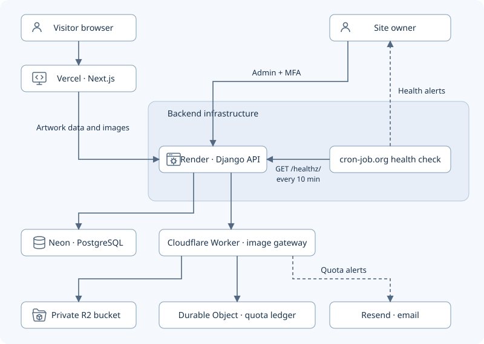
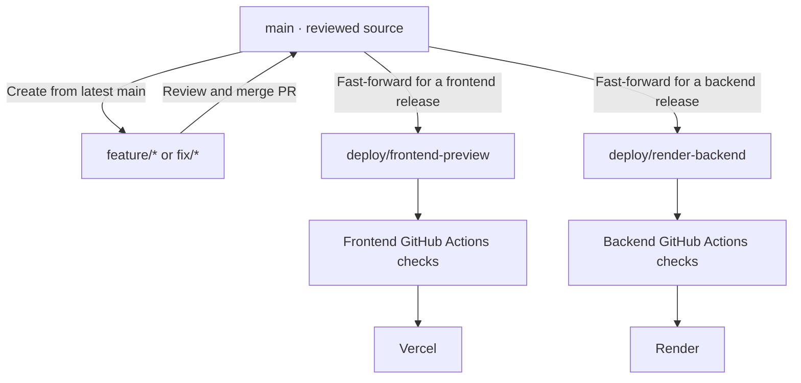
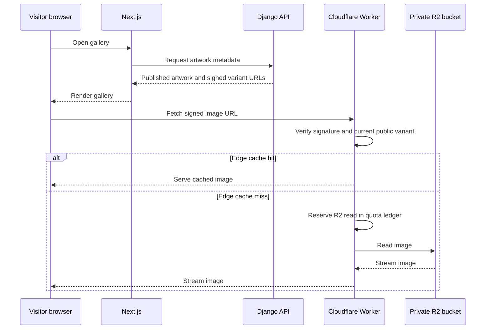

<h1 align="center">Personal Art Gallery</h1>

[](https://arts.kaancinar.com)

<p align="center">Visit the live portfolio →  <a href="https://arts.kaancinar.com"> arts.kaancinar.com</a></p>

This is the online home for Aydın Kaan Çınar's ceramics, objects, and illustrations. Visitors can browse the artwork and explore pottery forms in Clay Studio. The live site runs at **$0 in recurring infrastructure costs**, with the custom domain paid for separately.

## What is here

- **Gallery:** responsive artwork pages, categories, search, date filters, pagination, image viewer, and light/dark themes.
- **Clay Studio:** shape a vessel, estimate clay weight, undo and redo changes, save a design in the browser, or share it in a URL. The weight adjustment is provisional; see the [model notes](docs/CLAY_STUDIO.md).
- **Owner-only editing:** Django admin and API write routes are intended for Aydın Kaan Çınar alone. Sign-in requires a password, authenticator-app MFA, and an active session.
- **Sharing and discovery:** artwork-specific previews and metadata, a sitemap, robots rules, and structured data.

Visitors do not create accounts, check out, or upload artwork. [Clay Studio](https://arts.kaancinar.com/clay-studio) and the [privacy policy](https://arts.kaancinar.com/privacy) are also live.

## How it works



Next.js renders the public pages and asks Django for artwork data. Image URLs stay under the gallery domain through a Next.js rewrite, but Django checks publication and image-protection rules before reading files from the private gateway. The browser never receives R2 credentials or a direct bucket URL.

Django stores artwork records and staff sessions in Neon. The Cloudflare Worker reserves R2 usage before reads and writes, checks account usage every 15 minutes, and can stop billable access at conservative limits. Its cutoff is an application safeguard, not a Cloudflare billing guarantee. See the [gateway design](docs/R2_QUOTA_GATEWAY.html).

See the [image delivery investigation and benchmark](docs/IMAGE_DELIVERY.md) for the current request path, caching tradeoffs, and repeatable timing checks.

GitHub Actions applies the keepalive configuration when it changes on `main`. cron-job.org runs the checks and emails the owner on failure, recovery, or automatic disablement. See the [keepalive design](docs/DESIGN_DECISIONS.md#render-keepalive).

Gallery cards use small WebP variants, artwork pages use larger detail variants, and sharing links use 1200 × 630 previews. Clicking **View image** loads the original for unprotected work. For work with **Protect images** checked, all public copies are watermarked and the original remains staff-only. See [image behavior](frontend/README.md#image-delivery-and-search).

### Running the gallery at $0

Keeping infrastructure costs at $0 shaped the architecture from the start. The frontend runs on Vercel Hobby, Django on Render Free, and PostgreSQL on Neon Free. Images live in Cloudflare R2, with a Worker that tracks storage usage, sends quota alerts through Resend, and blocks billable storage operations at configured thresholds. Scheduled health checks keep Render active, and pre-generated WebP variants reduce the bytes transferred when visitors browse the gallery.

See the [hosting decisions and tradeoffs](docs/DESIGN_DECISIONS.md#keeping-hosting-costs-down).

### Where to look

| If you are changing… | Start here |
| --- | --- |
| Gallery pages, filters, navigation, viewer | [`frontend/app/`](frontend/app/), [`frontend/components/`](frontend/components/) |
| Clay Studio and its estimates | [`frontend/app/clay-studio/`](frontend/app/clay-studio/), [`frontend/lib/clay.ts`](frontend/lib/clay.ts), [model notes](docs/CLAY_STUDIO.md) |
| Metadata, sitemap, robots, privacy page | [`frontend/app/layout.tsx`](frontend/app/layout.tsx), [`frontend/app/sitemap.ts`](frontend/app/sitemap.ts), [`frontend/app/robots.ts`](frontend/app/robots.ts), [`frontend/app/privacy/page.tsx`](frontend/app/privacy/page.tsx) |
| Artwork data and admin | [`items/models.py`](items/models.py), [`items/serializers.py`](items/serializers.py), [`items/views.py`](items/views.py), [`items/admin.py`](items/admin.py) |
| Image generation and access | [`items/image_variants.py`](items/image_variants.py), [`items/validators.py`](items/validators.py), [`items/views.py`](items/views.py), [`frontend/next.config.ts`](frontend/next.config.ts) |
| Authentication and request limits | [`config/settings_base.py`](config/settings_base.py), [`config/settings_production.py`](config/settings_production.py), [`items/permissions.py`](items/permissions.py), [`items/public_read_limit.py`](items/public_read_limit.py) |
| R2 quota and alerts | [`cloudflare/r2-gateway/`](cloudflare/r2-gateway/), [`items/storage_gateway.py`](items/storage_gateway.py) |
| Builds and releases | [`Dockerfile`](Dockerfile), [GitHub workflows](.github/workflows/), [branch workflow](docs/BRANCH_WORKFLOW.md) |

The Django app lives in `items/`, but its database app label is `tasks` for migration compatibility. Use that label if an app-specific migration command needs one.

## Run it locally

For a fresh, empty gallery, use Python 3.12 and Node.js 24. The default Django settings use local SQLite; private credentials are not needed for this path.

```bash
python3.12 -m venv .venv
./.venv/bin/python -m pip install -r requirements-lock.txt
./.venv/bin/python manage.py migrate
./.venv/bin/python manage.py runserver
```

In another terminal:

```bash
cd frontend
npm ci
npm run dev
```

Open [localhost:3000](http://localhost:3000). `BACKEND_ORIGIN` defaults to `http://127.0.0.1:8000`; `SITE_URL` controls canonical and sharing URLs. A fresh database has no artwork until you add it in Django admin and publish it. Admin setup begins at [the MFA login](http://127.0.0.1:8000/account/login/).

On the project workstation, [Docker Compose](docs/LOCAL_DOCKER.md) is the usual local backend: it uses a private, ignored `.env.docker` file and connects to Neon and the R2 gateway. The [Neon setup guide](docs/NEON_SETUP.md) explains the alternative virtual-environment connection. **Check which database and storage settings are active before changing real artwork.** Never commit `.env.*`, database dumps, MFA recovery codes, or original media.

## Check a change

```bash
./.venv/bin/python manage.py check
./.venv/bin/python manage.py makemigrations --check --dry-run
./.venv/bin/python manage.py test

cd frontend
npm test
npm run lint
npm run build
npx playwright install chromium  # first browser-test run only
npm run test:browser

cd ../cloudflare/r2-gateway
npm ci
npm test
```

Run the checks relevant to your change. Django's default test command uses an isolated SQLite test database; the [PostgreSQL testing guide](docs/POSTGRES_TESTING.html) covers an isolated Neon branch. Browser tests exercise desktop and phone journeys against a temporary backend. Gateway tests use local Cloudflare bindings, not the live bucket.

## How changes reach the site



`main` is the source of truth. The deployment branches can lag until that part of the site is ready to release. Never merge a feature directly into either deployment branch. The [branch workflow](docs/BRANCH_WORKFLOW.md) has the exact commands.

The [frontend workflow](.github/workflows/vercel-frontend.yml) runs tests and deploys Vercel when frontend files change on its deployment branch. The [backend workflow](.github/workflows/render-backend.yml) tests and builds the Docker image before asking Render to deploy its commit. A workflow accepting a deploy is not proof that the live release is healthy; check the hosting dashboard and site. Database migrations are a separate release step, using a reviewed direct Neon connection. Secrets belong in the providers' private settings, not in Git or frontend `NEXT_PUBLIC_*` variables.

## Current operating notes

- The frontend runs on Vercel Hobby at `arts.kaancinar.com`; the Docker backend runs on Render Free in Virginia and may be slow to wake after idle time. The root `kaancinar.com` website is a separate site.
- Neon holds the production PostgreSQL database. Original artwork and variants live in a private Cloudflare R2 bucket behind the Worker. The Worker uses a conservative billing hold because the exact R2 renewal hour has not been verified; review the [gateway runbook](cloudflare/r2-gateway/README.md) before the December 10 boundary.
- Vercel Bot Protection and an image-request rate rule are enabled. Direct requests to the Render origin still need a stronger ingress plan. Backups, a restore test, broader monitoring, and a wider real-device/browser pass remain release work.
- A [privacy policy](frontend/app/privacy/page.tsx) is live. Owner-only login does not prevent automated login attempts or provider request logging. The current review still needs a retention routine for security records and expired sessions, a live cookie/provider-settings check, and an assessment of Vercel Hobby terms and data preferences. Keep policy claims aligned with verified behavior.

For deeper context, read the [design decisions](docs/DESIGN_DECISIONS.md), [frontend guide](frontend/README.md), [security notes](docs/SECURITY_IMPLEMENTATION.md), [Render deployment record](docs/RENDER_DEPLOYMENT.md), and [Vercel deployment record](docs/VERCEL_FRONTEND_DEPLOYMENT.md). Deployment records include historical setup steps; current code and provider settings take precedence when they differ.


## Roadmap

### Serve public artwork images from Cloudflare

The gallery started as a Django backend, with publishing rules and image delivery in the same service. When Next.js was added, it reused that path. Today Django still checks publication and image protection, then buffers the image from Cloudflare and relays it through Vercel. The goal is to keep those publishing controls while letting the browser fetch public image variants directly from Cloudflare.



- **Keep publishing rules in force.** Start with gallery cards. Django issues one-hour HMAC-signed URLs scoped to an immutable public variant. The Worker checks the signature, expiry, and current public variant mapping before serving cached bytes. Unpublishing, replacing an image, or enabling watermark protection must revoke the previous mapping. Keep staff previews, protected originals, and uploads on the authenticated path.
- **Reduce latency and load.** Direct delivery removes the image relay through Render in Virginia and through Vercel. Edge cache hits can also avoid an R2 read. Offloading reduces Render bandwidth and Gunicorn work. The [750-hour monthly allowance](https://render.com/docs/free#free-instance-hours) is based on service uptime, so a continuously warm backend still uses the same instance hours.
- **Reduce the impact of backend outages.** Already-issued URLs can keep working during a Render restart or Neon outage while they remain valid and Cloudflare can serve the image. Fresh gallery metadata and URL issuance still depend on Django and Neon.
- **Measure the full gallery load.** Compare card time to first byte, time until cards appear, Render bandwidth, and R2 reads across warm and cold edge caches. Test revocation with previously issued URLs and apply rate limits on the public Worker route. See the [image delivery benchmark](docs/IMAGE_DELIVERY.md) and [Cloudflare cache behavior](https://developers.cloudflare.com/workers/runtime-apis/cache/).

### Benchmark Rust for the image gateway

Prototype a Rust/WebAssembly implementation and compare it with the JavaScript Worker on signature verification, cache hits, and R2 reads. Measure Worker CPU time, end-to-end latency, and bundle size. Keep the quota and authorization behavior covered by the same tests, and use the results to decide whether to migrate.

### Trace requests with OpenTelemetry

Instrument Next.js, Django, and the Worker to see where time goes across metadata requests, database calls, image delivery, and cache misses. Send sampled traces to Grafana Cloud Free. Use route templates and timing data, and exclude raw URLs, query strings, signed image URLs, credentials, cookies, and request bodies from exported telemetry.

Before enabling export, verify the data fields and retention in the configured Grafana stack. Update the privacy policy to explain what operational data is collected, why it is used, who processes it, and how long it is kept. [Grafana Cloud Free currently lists 14 days of trace retention.](https://grafana.com/products/cloud/traces/)
